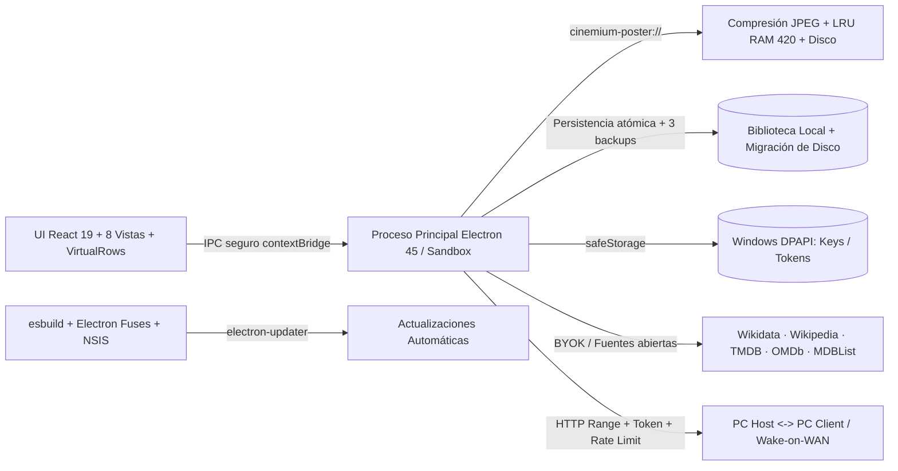

# Cinemium — Caso de Estudio (Aplicación Desktop Windows)

> **Repositorio Showcase (sin código fuente):** Este repositorio documenta la arquitectura, capacidades técnicas y diseño de seguridad de **Cinemium**. El código fuente y los instaladores se mantienen privados por tratarse de software propietario (*All Rights Reserved*).
>
> **Estado actual:** En desarrollo activo y en uso por **1 usuario real** en Windows (próxima etapa: compatibilidad macOS/Linux).

---

## Resumen

- **Tipo:** Aplicación de escritorio para Windows (instalable `.exe` con actualizaciones automáticas)
- **Mi rol:** Ideación, definición de arquitectura y requerimientos, desarrollo asistido por IA, validaciones de seguridad, pruebas funcionales y empaquetado de distribución
- **Escala:** ~28.000 líneas de código en 29 módulos principales
- **Stack utilizado:** React 19, TypeScript 5.8, Vite 6, Tailwind CSS 3, Electron 45, Node.js, `electron-builder` (NSIS), `electron-updater`, `@electron/fuses`, `esbuild`, Windows DPAPI (`safeStorage`)

---

## Qué resuelve

Centraliza la catalogación, exploración y reproducción de bibliotecas locales y remotas de películas y series en una única aplicación de escritorio rápida, personalizable y resiliente ante catálogos grandes o pérdida de conectividad.

---

## Arquitectura (Sin exponer código ni interfaz)

---

## Capacidades Principales

1. **Catálogo, Consultas Lógicas y 8 Vistas Visuales**
   - 8 interfaces intercambiables sobre una arquitectura unificada (*Estantería MDB*, *Red*, *Purple*, *Blue*, *Black*, *Videoclub 90s*, *Sala TV* y *Tabla MDB*).
   - Filtrado multifaceta (géneros con inclusión/exclusión `AND`/`OR`, décadas, reparto, dirección, premios, puntajes, resolución y etiquetas), constructor visual de consultas lógicas y colecciones inteligentes guardables.
   - Escaneo de carpetas locales, detección y fusión de duplicados, perfiles de elenco/dirección, estadísticas, importación/exportación CSV/XML (compatible con EMDB y Letterboxd) y selector aleatorio.

2. **Reproductor Embebido e Integración con Windows**
   - Reproductor integrado con 5 distribuciones configurables, subtítulos personalizables en tiempo real con contraste WCAG (AA/AAA), sincronización audio/subtítulos, amplificación hasta 200% (Web Audio API) y registro de progreso.
   - Detección automática de reproductores externos instalados en Windows (rutas estándar, `PATH` y registro `App Paths`) y lanzamiento seguro con parámetros de tiempo y subtítulos.

3. **Streaming Privado Host/Client y Wake-on-WAN**
   - Servidor HTTP nativo con soporte de *Range Requests* para transmitir biblioteca y video entre una PC Principal (Host) y equipos secundarios (Client) en red local o Tailscale, con autenticación por token criptográfico, *rate limiting* y encendido remoto (Wake-on-LAN / Webhook ESP32).

4. **Rendimiento y Resiliencia de Datos**
   - Virtualización de grillas (`VirtualRows`) y modo GPU ligera.
   - Protocolo propio `cinemium-poster://` con compresión JPEG (~12–20 KB) en disco y caché LRU en RAM.
   - Escrituras atómicas (`.tmp` + `rename`), rotación automática de 3 copias de respaldo con autorecuperación y migración de directorio/disco de datos desde la app.

5. **Enriquecimiento Multi-Fuente y Arquitectura BYOK**
   - Integración concurrente en segundo plano con fuentes abiertas (Wikidata CC0, Wikipedia CC BY-SA 4.0) y soporte opcional *Bring Your Own Key* (TMDB, OMDb, MDBList).

6. **Seguridad Endurecida y Distribución**
   - Electron configurado con `sandbox: true`, `contextIsolation: true`, `nodeIntegration: false`, CSP estricto en producción, DevTools bloqueadas en builds finales y 6 **Electron Fuses** (validación de integridad ASAR, `OnlyLoadAppFromAsar`, bloqueo de `RunAsNode` e inspector CLI).
   - Guardas contra *path traversal*, SSRF y *argument injection*; cifrado de secretos en reposo con **Windows DPAPI** (`safeStorage`).
   - Empaquetado automatizado con `electron-builder` (instalador NSIS con EULA) y soporte de actualizaciones diferenciales con `electron-updater` (`.blockmap`).

---

## Contacto

- **Email laboral:** `joaquindiazstefani00@gmail.com`
- **LinkedIn:** [Joaquín Díaz Stefani](https://www.linkedin.com/in/joaquindiazstefani)
