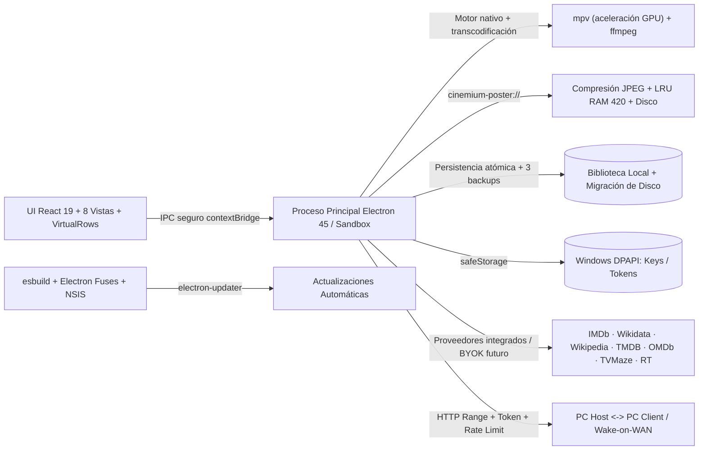

# Cinemium — Caso de Estudio (Aplicación Desktop Windows)

> **Repositorio Showcase (sin código fuente):** Este repositorio documenta la arquitectura, capacidades técnicas y diseño de seguridad de **Cinemium**. El código fuente y los instaladores permanecen privados por tratarse de software propietario (*All Rights Reserved*).
>
> **Estado actual:** En desarrollo activo y en uso por **1 usuario real** en Windows (proyecto aún no comercial; próxima etapa: compatibilidad macOS/Linux).

---

## Resumen

- **Tipo:** Aplicación de escritorio para Windows (instalable `.exe` con actualizaciones automáticas)
- **Mi rol:** Ideación, definición de arquitectura y requerimientos, desarrollo asistido por IA, validaciones de seguridad, pruebas funcionales y empaquetado de distribución
- **Escala:** ~37.000 líneas de código distribuidas en 31 módulos principales
- **Stack utilizado:** React 19, TypeScript 5.8, Vite 6, Tailwind CSS 3, Electron 45, Node.js, `mpv`, `ffmpeg`, `electron-builder` 26 (NSIS), `electron-updater` 6, `@electron/fuses`, `esbuild`, Windows DPAPI (`safeStorage`)

---

## Qué resuelve

Centraliza la catalogación, exploración, organización de series/películas y reproducción de bibliotecas locales y remotas en una aplicación de escritorio rápida, personalizable y resiliente ante catálogos grandes o falta de conectividad.

---

## Arquitectura (Sin exponer código ni interfaz)

---

## Capacidades Principales

1. **Catálogo, Escaneo Inteligente de Series y 8 Vistas Visuales**
   - 8 interfaces visuales intercambiables sobre una arquitectura unificada (*Estantería MDB*, *Red*, *Purple*, *Blue*, *Black*, *Videoclub 90s*, *Sala TV* y *Tabla MDB*).
   - **Reconocimiento por jerarquía de carpetas:** analiza desde el archivo hacia las carpetas padre para deducir títulos de películas y series con precisión.
   - **Agrupación automática de series (`Serie → Temporada → Capítulo`)** en una única ficha unificada: interpreta convenciones como `Season 1..4`, `Temporada N`, `S01`, `Series 2` y numeración romana, separando subcarpetas de `Piloto` y `Extras/Especiales`.
   - Vista dedicada **"Temporadas y Episodios"** con acordeones multi-expansibles, conteo de episodios locales y vistos, botón de reproducción por temporada, consolidación en un clic de fichas escaneadas por separado y herramientas manuales para fusionar o separar capítulos.
   - Filtrado multifaceta (géneros con inclusión/exclusión `AND`/`OR`, décadas, reparto, dirección, premios/Oscars, puntajes, resolución y etiquetas), constructor visual de consultas lógicas, colecciones inteligentes guardables, detección y fusión de duplicados, perfiles de elenco/dirección, estadísticas, importación/exportación CSV/XML y selector aleatorio.

2. **Reproductor Nativo (`mpv` + `ffmpeg`) e Integración con Windows**
   - **Motor de reproducción nativo `mpv`** con aceleración por hardware (GPU) y **`ffmpeg` incluido** para transcodificación en vivo.
   - Ventana de reproducción estable, sincronizada con la ventana principal bajo un único ícono en la barra de tareas, 5 distribuciones configurables y salida limpia de pantalla completa con `ESC`.
   - Subtítulos personalizables en tiempo real (tamaño, color, fondo y borde) aplicados de forma uniforme en el reproductor, con ajuste de sincronización audio/subtítulos y cálculo de contraste WCAG (AA/AAA).
   - Amplificación de volumen hasta **200 %** (`--volume-max=200` en `mpv`, con Web Audio API como respaldo cuando no se utiliza el motor nativo).
   - Seguimiento automático de progreso en **"Continuar viendo"** dentro del reproductor integrado (con acciones rápidas para marcar como visto o quitar de la lista) y botón de tráiler directo.
   - Descubrimiento dinámico de reproductores externos instalados en Windows (rutas estándar, `PATH` y registro `App Paths`) y lanzamiento seguro con parámetros de tiempo y subtítulos.

3. **Metadatos a Demanda, Gestión de Portadas y Archivos**
   - **Carga a demanda por proveedor** con vista previa de cada campo (sinopsis, reparto, portada, premios) para elegir de qué fuente tomar cada dato, evitando sobreescrituras masivas por defecto.
   - Puntajes de crítica y público (`Tomatometer/Popcornmeter`, `Metacritic`, `IMDb`) y premios internacionales incluyendo Oscars.
   - Selector de portadas alternativas, búsqueda de imágenes web desde la ficha y carga personalizada desde archivo, arrastrar y soltar o portapapeles con compresión automática.
   - Encuadre configurable `2:3` o sin recortes, y halo/destello de carátulas personalizable con diferenciación visual entre películas y series.
   - Remapeo de rutas para archivos renombrados o movidos, acceso directo para abrir su carpeta contenedora y recálculo actualizado de tamaño (`MB`/`GB`) al abrir la ficha.

4. **Fuentes de Datos y Modelo de Licencias**
   - **Uso actual (no comercial):** las fuentes vienen integradas y operan listas para usar sin configuración previa del usuario: **IMDb**, **Cinemeta**, **Wikidata**, **Wikipedia (ES/EN)**, **TVMaze**, **Rotten Tomatoes**, **Metacritic**, **TMDB**, **OMDb** y **MDBList**, además de importación de texto copiado desde **FilmAffinity**.
   - **Proyección comercial (arquitectura BYOK):** ante un eventual lanzamiento comercial, el sistema cambia a un modelo *Bring Your Own Key* (BYOK): permanecen integradas únicamente las fuentes abiertas compatibles con uso comercial bajo atribución (**Wikidata CC0** y **Wikipedia CC BY-SA 4.0**), mientras que cada cliente configura sus propias claves en los proveedores restantes mediante guías y enlaces integrados en la app, mostrando los créditos correspondientes. *Esta separación responde a una decisión deliberada de diseño y cumplimiento legal/comercial, no a una limitación técnica.*

5. **Streaming Privado Host/Client y Wake-on-WAN**
   - Servidor HTTP nativo con soporte de *Range Requests* para transmitir biblioteca y video entre una PC Principal (Host) y equipos secundarios (Client) en red local o Tailscale, con autenticación por token criptográfico, *rate limiting* y encendido remoto (Wake-on-LAN / Webhook ESP32).

6. **Rendimiento y Resiliencia de Datos**
   - Virtualización de grillas (`VirtualRows`) y modo GPU ligera para catálogos extensos.
   - Protocolo interno `cinemium-poster://` con compresión JPEG (~12–20 KB) en disco y caché LRU en RAM.
   - Escrituras atómicas (`.tmp` + `rename`), rotación automática de 3 copias de respaldo con autorecuperación y migración de directorio/disco de datos desde la app.

7. **Seguridad Endurecida y Distribución**
   - Electron configurado con `sandbox: true`, `contextIsolation: true`, `nodeIntegration: false`, CSP estricto en producción, DevTools bloqueadas en builds finales y 6 **Electron Fuses** (validación de integridad ASAR, `OnlyLoadAppFromAsar`, bloqueo de `RunAsNode` e inspector CLI).
   - Guardas contra *path traversal*, SSRF y *argument injection*; cifrado de secretos en reposo con **Windows DPAPI** (`safeStorage`).
   - Empaquetado automatizado con `electron-builder` 26 (instalador NSIS con EULA) y soporte de actualizaciones diferenciales con `electron-updater` 6 (`.blockmap`).

---

## Contacto

- **Email laboral:** `joaquindiazstefani00@gmail.com`
- **LinkedIn:** [Joaquín Díaz Stefani](https://www.linkedin.com/in/joaquindiazstefani)
